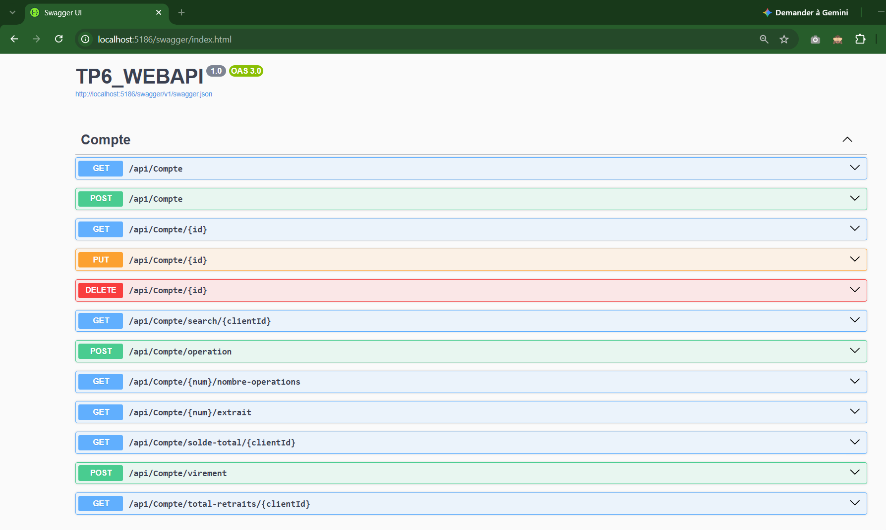
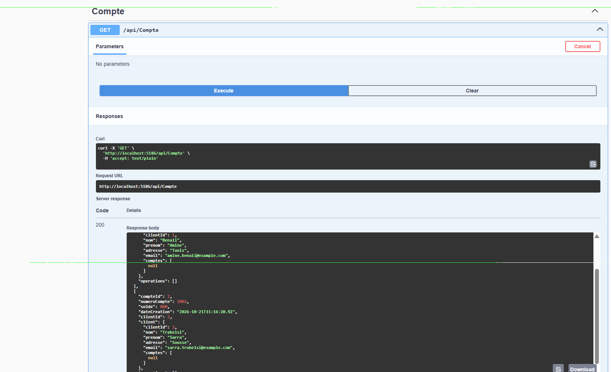
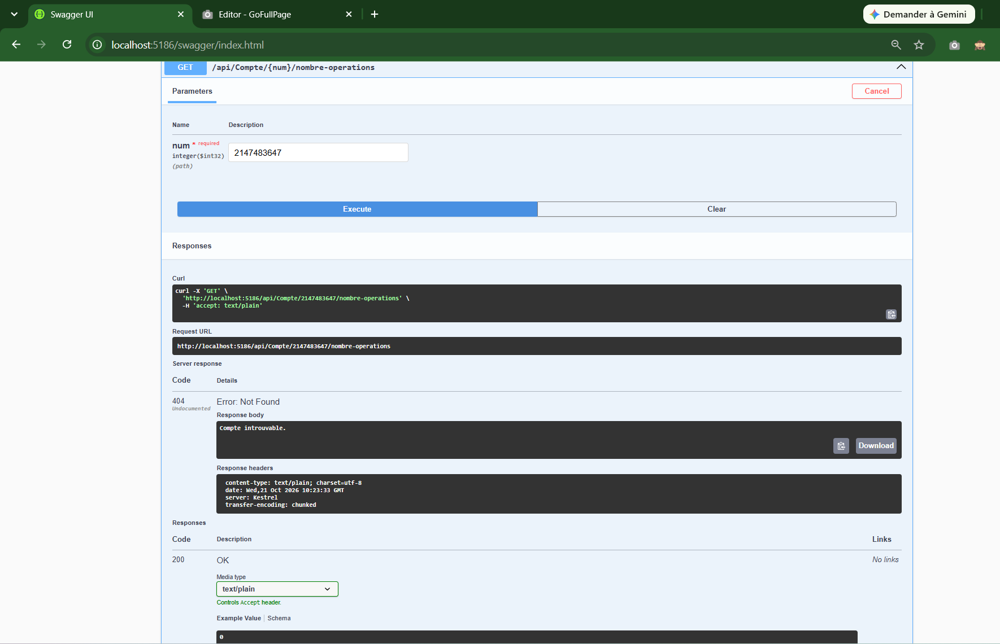
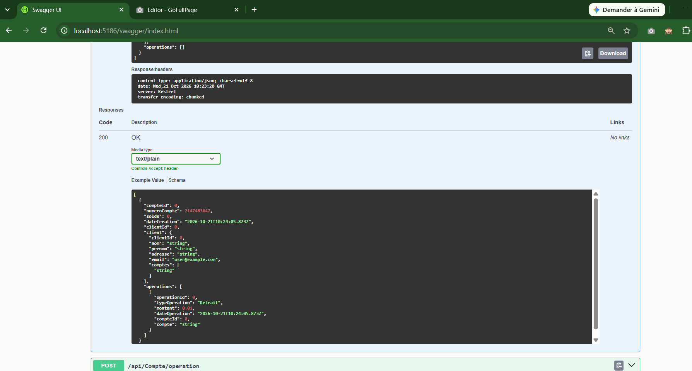
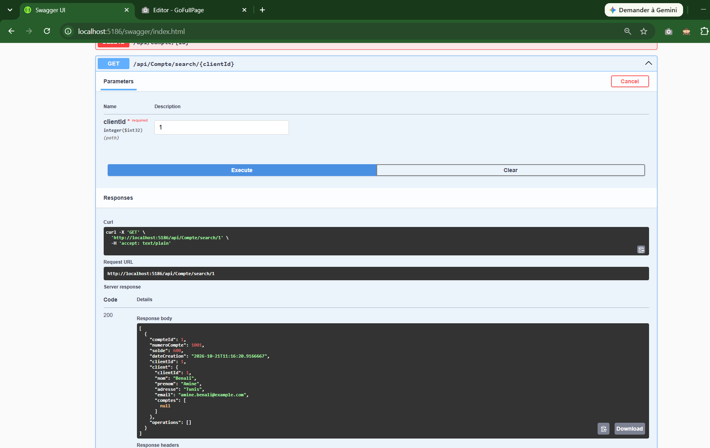
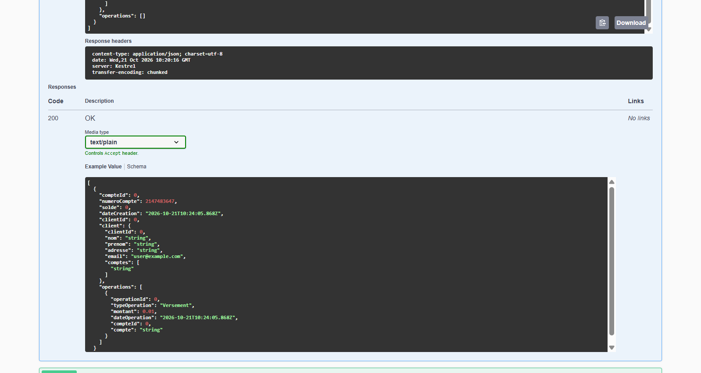

# Compte rendu - TP 6 : Web API de gestion des comptes bancaires

> Document de travail à compléter avec les captures d'écran des étapes réalisées.

## 1. Présentation du projet

L'objectif du TP est de développer une API Web ASP.NET Core permettant de gérer des clients, des comptes bancaires et leurs opérations, avec Entity Framework Core et SQL Server.

Projet créé : `TP6_WEBAPI`

Framework utilisé : `.NET 8.0`

## 2. Création du projet et installation des packages

Le projet a été créé avec le modèle ASP.NET Core Web API.

Packages installés :

```text
Microsoft.EntityFrameworkCore.SqlServer 8.0.22
Microsoft.EntityFrameworkCore.Design    8.0.22
Microsoft.EntityFrameworkCore.Tools     8.0.22
Microsoft.AspNetCore.OpenApi            8.0.22
Swashbuckle.AspNetCore                  6.6.2
```

## 3. Création des modèles

Les modèles créés sont :

- `Models/Client.cs`
- `Models/Compte.cs`
- `Models/Operation.cs`

Relations définies :

- un client possède plusieurs comptes ;
- un compte appartient à un client ;
- un compte possède plusieurs opérations ;
- une opération appartient à un compte.

## 4. Création du contexte Entity Framework

Le fichier `Data/AppDbContext.cs` contient les `DbSet` suivants :

```csharp
public DbSet<Client> Clients => Set<Client>();
public DbSet<Compte> Comptes => Set<Compte>();
public DbSet<Operation> Operations => Set<Operation>();
```

Le numéro de compte est unique et les relations entre les entités sont configurées avec Entity Framework Core.

## 5. Configuration de SQL Server

La chaîne de connexion est définie dans `appsettings.json` :

```json
"ConnectionStrings": {
  "DbConnection": "Server=(localdb)\\MSSQLLocalDB;Database=bd;Trusted_Connection=True;TrustServerCertificate=True"
}
```

Le contexte est enregistré dans `Program.cs` :

```csharp
builder.Services.AddDbContext<AppDbContext>(options =>
    options.UseSqlServer(
        builder.Configuration.GetConnectionString("DbConnection")));
```

Pour éviter les boucles de sérialisation entre `Client` et `Compte`, les cycles JSON sont ignorés :

```csharp
builder.Services.AddControllers()
    .AddJsonOptions(options =>
    {
        options.JsonSerializerOptions.ReferenceHandler = ReferenceHandler.IgnoreCycles;
    });
```

## 6. Repository

Les fichiers suivants ont été créés :

- `Repositories/ICompteRepository.cs`
- `Repositories/CompteRepository.cs`

Le repository contient les opérations de lecture, d'ajout, de modification et de suppression des comptes, ainsi que la gestion des opérations, des soldes, des virements et des retraits.

## 7. Migration et création de la base de données

Commandes exécutées :

```powershell
dotnet ef migrations add InitialCreate
dotnet ef database update
```

Résultat : la base `bd` a été créée dans SQL Server LocalDB avec les tables `Clients`, `Comptes` et `Operations`.

## 8. Contrôleur API

Le contrôleur est :

```text
Controllers/CompteController.cs
```

Il expose les endpoints de gestion des comptes, des opérations, des soldes, des virements et des retraits.

## 9. Test avec Swagger

Swagger est disponible à l'adresse :

```text
http://localhost:5186/swagger/index.html
```

Le test de l'endpoint suivant a été effectué :

```text
GET /api/Compte
```

Résultat obtenu :

```text
HTTP 200 OK
Réponse : []
```

Cette première réponse vide était normale puisque la base ne contenait pas encore de données.

Après l'insertion des données de test, le même endpoint retourne les comptes `1001` et `1002` avec le code `200 OK`.

Les tests Swagger avec les données de test sont détaillés dans la section 10 bis.

## 10. Vérification de compilation

Commande exécutée :

```powershell
dotnet build
```

Résultat :

```text
La génération a réussi.
0 erreur
0 avertissement
```

## 10 bis. Données de test et exemples complets

Deux clients et deux comptes ont été ajoutés avec le script :

```text
Scripts/TestData.sql
```

| Client | ClientId | CompteId | Numéro de compte | Solde initial |
|---|---:|---:|---:|---:|
| Amine Benali | 1 | 1 | 1001 | 0 |
| Sarra Trabelsi | 2 | 2 | 1002 | 0 |

### Exemple 1 - Client Amine et compte 1001

1. Ajouter un versement de 500 :

```json
{
  "typeOperation": "Versement",
  "montant": 500,
  "compteId": 1
}
```

Endpoint : `POST /api/Compte/operation`

2. Ajouter un retrait de 100 :

```json
{
  "typeOperation": "Retrait",
  "montant": 100,
  "compteId": 1
}
```

3. Vérifier les résultats :

```text
GET /api/Compte/1
GET /api/Compte/1001/nombre-operations
GET /api/Compte/1001/extrait?date=2026-01-01T00:00:00
GET /api/Compte/solde-total/1
GET /api/Compte/total-retraits/1
```

Résultat attendu avant le virement : solde `400`, nombre d'opérations `2`, total des retraits `100`.

### Exemple 2 - Client Sarra et compte 1002

1. Ajouter un versement de 1000 :

```json
{
  "typeOperation": "Versement",
  "montant": 1000,
  "compteId": 2
}
```

2. Effectuer un virement de 200 du compte 1002 vers le compte 1001 :

```text
POST /api/Compte/virement?num1=1002&num2=1001&montant=200
```

3. Vérifier les résultats :

```text
GET /api/Compte
GET /api/Compte/search/2
GET /api/Compte/1002/nombre-operations
GET /api/Compte/solde-total/2
GET /api/Compte/total-retraits/2
```

Résultat attendu après les deux exemples : compte `1001` à `600` et compte `1002` à `800`.

Résultat obtenu après exécution :

```text
Compte 1001 : solde 600, nombre d'opérations 2, total des retraits 100
Compte 1002 : solde 800, nombre d'opérations 1, total des retraits 0
Virement 1002 vers 1001 : succès
```

### Résultats détaillés des endpoints calculés

Les tests ont été exécutés avec Swagger sur les valeurs suivantes :

| Endpoint | Paramètres | Code HTTP | Résultat |
|---|---|---:|---:|
| `GET /api/Compte/1001/nombre-operations` | compte `1001` | 200 | `2` opérations |
| `GET /api/Compte/1001/extrait?date=2026-01-01T00:00:00` | compte `1001` | 200 | versement `500` et retrait `100` |
| `GET /api/Compte/solde-total/1` | client `1` | 200 | `600` |
| `GET /api/Compte/total-retraits/1` | client `1` | 200 | `100` |
| `GET /api/Compte/total-retraits/2` | client `2` | 200 | `0` |

Le résultat `404` obtenu avec le numéro `2147483647` était normal : ce numéro est la valeur proposée par défaut par Swagger et ne correspond à aucun compte existant.

### Tests supplémentaires

```text
GET    /api/Compte
GET    /api/Compte/1
POST   /api/Compte
PUT    /api/Compte/1
DELETE /api/Compte/1
GET    /api/Compte/search/1
POST   /api/Compte/operation
GET    /api/Compte/1001/nombre-operations
GET    /api/Compte/1001/extrait?date=2026-01-01T00:00:00
GET    /api/Compte/solde-total/1
POST   /api/Compte/virement?num1=1001&num2=1002&montant=50
GET    /api/Compte/total-retraits/1
```

Les endpoints de création, modification et suppression ont également été vérifiés avec un compte temporaire :

```text
POST   /api/Compte       => 201 Created, compte 1003
PUT    /api/Compte/3     => 200 OK, numéro modifié en 1004
DELETE /api/Compte/3     => 200 OK
```

## 11. Emplacements des captures d'écran

Les captures suivantes doivent être insérées dans les emplacements indiqués ci-dessous.

### Capture 1 - Création du projet

**Emplacement :** après la section 2.

Insérer une capture montrant le projet `TP6_WEBAPI` dans Visual Studio ou dans l'explorateur de fichiers.

```text
[ INSÉRER ICI LA CAPTURE 1 : création du projet et structure initiale ]
```

### Capture 2 - Installation des packages NuGet

**Emplacement :** après la liste des packages de la section 2.

Insérer une capture de la fenêtre NuGet ou de la commande `dotnet list package`.

```text
[ INSÉRER ICI LA CAPTURE 2 : packages NuGet installés ]
```

### Capture 3 - Création des modèles

**Emplacement :** après la section 3.

Insérer une capture de l'arborescence contenant `Client.cs`, `Compte.cs` et `Operation.cs`.

```text
[ INSÉRER ICI LA CAPTURE 3 : dossier Models et classes ]
```

### Capture 4 - AppDbContext

**Emplacement :** après la section 4.

Insérer une capture du fichier `Data/AppDbContext.cs` et de ses `DbSet`.

```text
[ INSÉRER ICI LA CAPTURE 4 : classe AppDbContext ]
```

### Capture 5 - Configuration SQL Server

**Emplacement :** après la section 5.

Insérer une capture de `appsettings.json` et de l'enregistrement du contexte dans `Program.cs`.

```text
[ INSÉRER ICI LA CAPTURE 5 : chaîne de connexion et injection du contexte ]
```

### Capture 6 - Repository

**Emplacement :** après la section 6.

Insérer une capture de `ICompteRepository.cs` et `CompteRepository.cs`.

```text
[ INSÉRER ICI LA CAPTURE 6 : interface et implémentation du repository ]
```

### Capture 7 - Migration et base de données

**Emplacement :** après la section 7.

Insérer une capture de la console montrant les commandes `dotnet ef migrations add InitialCreate` et `dotnet ef database update` terminées avec succès.

```text
[ INSÉRER ICI LA CAPTURE 7 : migration et création de la base bd ]
```

### Capture 8 - Contrôleur API

**Emplacement :** après la section 8.

Insérer une capture de `Controllers/CompteController.cs` et de l'arborescence des endpoints.

```text
[ INSÉRER ICI LA CAPTURE 8 : CompteController ]
```

### Capture 9 - Interface Swagger

**Emplacement :** au début de la section 9.

Insérer une capture de la page Swagger affichant la liste des endpoints `Compte`.



Capture enregistrée dans `Captures/Capture_09_Swagger_Endpoints.png`.

### Capture 10 - Test GET /api/Compte

**Emplacement :** après le résultat du test dans la section 9.

Insérer une capture montrant la requête `GET /api/Compte`, le code `200` et la réponse JSON.



Capture enregistrée dans `Captures/Capture_14_Get_Comptes_200.png`.

### Capture 10 bis - Test avec un numéro inexistant

Une première saisie avec le numéro par défaut `2147483647` a produit une réponse `404 Not Found`. Cette erreur est normale car ce numéro de compte n'existe pas dans la base.



### Capture 11 - Tests avec données

**Emplacement :** à ajouter après l'insertion des données de test.

Insérer les captures des tests de création de compte, versement, retrait, virement et calcul du solde.







Captures enregistrées dans le dossier `Captures`.

## 12. Checklist finale

- [x] Projet créé.
- [x] Packages NuGet installés.
- [x] Modèles créés.
- [x] `AppDbContext` créé.
- [x] SQL Server configuré.
- [x] Repository créé.
- [x] Contrôleur créé.
- [x] Migration appliquée.
- [x] Swagger configuré.
- [x] Test `GET /api/Compte` réalisé.
- [x] Ajouter les données de test.
- [x] Tester tous les endpoints avec Swagger.
- [ ] Remplacer tous les emplacements par les captures finales.

